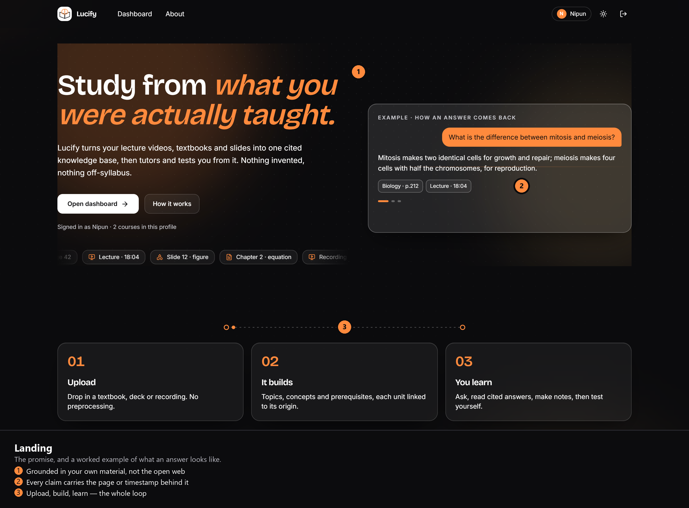
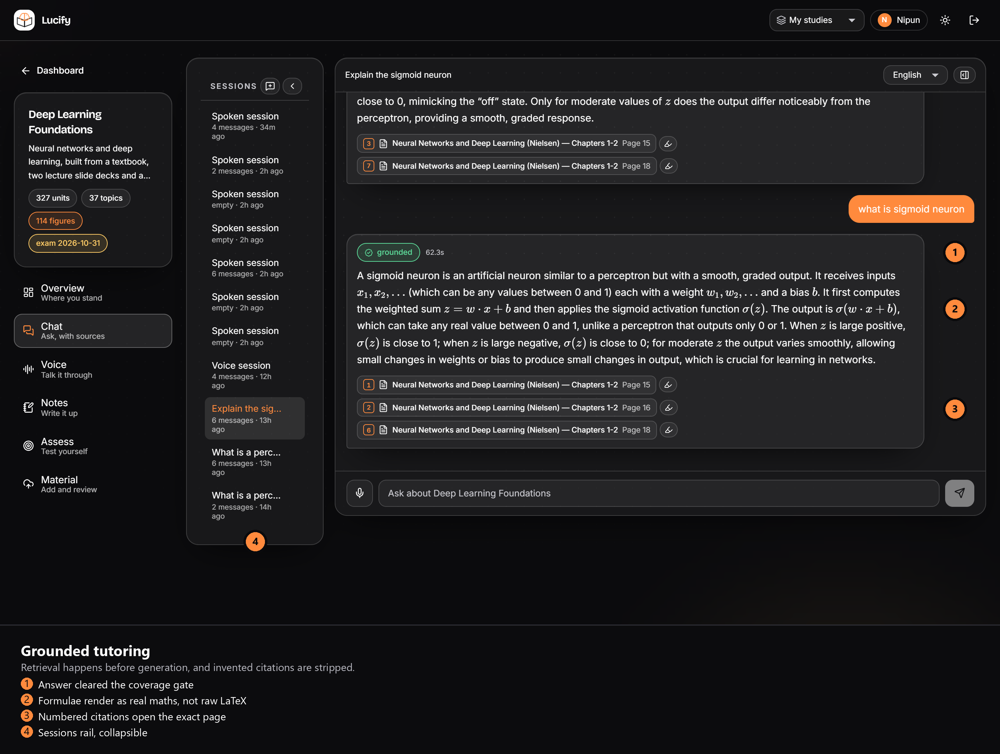
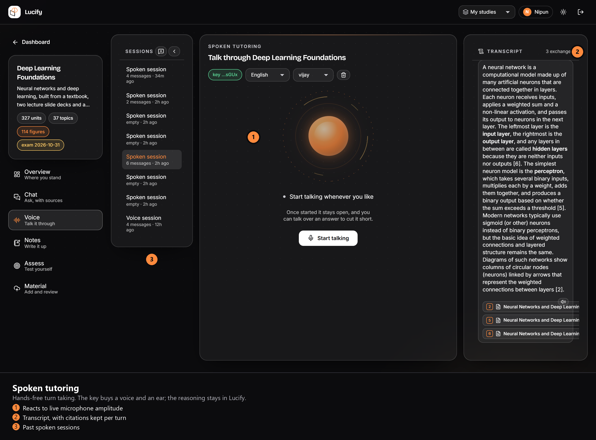
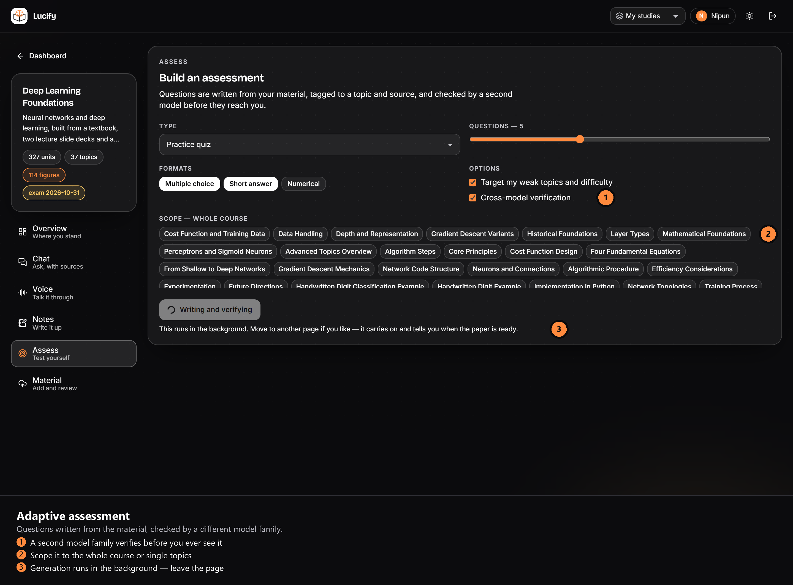

# Gallery

## Demo


[lucify-demo.mp4](gallery/lucify-demo.mp4) — four minutes, captioned, recorded against a
local instance. It runs the whole path: the key gate, a document ingested from scratch,
a grounded answer with a citation opened at the highlighted lines, a refusal, notes,
background assessment generation, spoken tutoring and the memory page.

The wait while the ingest finished is cut, and the cut is labelled on screen.


Five screens, captured from the running app at 1440×900 on a 2× display. Each has a plain
version and an `-annotated` version with numbered callouts, in `docs/gallery/`.

---

## Landing



The claim and a worked example side by side. The example panel cycles through three
exchanges, and the third is **refused on purpose** — a question the material does not cover
is declined rather than guessed, which is the whole point of the product.

---

## Course overview — the learner model


Mastery comes from Bayesian knowledge tracing over every answered question, not an average
of quiz scores. The course flow is a prerequisite graph **derived from the material itself**,
coloured by how well each area is known, and the suggested next step is the weakest topic by
urgency rather than the first unfinished one.

---

## Grounded tutoring



The most important screen. Retrieval runs before generation; the answer only appears because
it cleared the coverage gate, and every citation was validated against what was actually
retrieved — markers the model invented are stripped before you see them. Each citation opens
the exact page.

Note the maths: `σ(z)`, `z = w·x + b` and the subscripted inputs render as real formulae
rather than raw LaTeX source.

---

## Spoken tutoring



Hands-free: voice activity detection decides when a turn ends, so there is nothing to press,
and talking over an answer cuts it short. The orb reacts to live microphone amplitude while
listening and to playback amplitude while speaking.

The Sarvam key buys a voice and an ear and nothing else — retrieval, grounding, citation and
the learner model all stay inside Lucify. Spoken answers keep their citations, visible in the
transcript rail.

---

## Adaptive assessment



Questions are written from the material, tagged to a topic and a source location, then
checked by a **different model family** from the one that wrote them — genuine cross-model
verification rather than a model marking its own work. Duplicates are caught by fingerprint
and embedding similarity before they reach the bank.

Generation runs in the background: start it, move to another page, and it tells you when the
paper is ready.

---

## Reproducing these

```bash
# with the app running on :3000
node capture.js        # Playwright, driving the installed Chrome at 1440x900 @2x
python annotate.py     # Pillow, draws the callouts and caption strips
```

Both scripts live outside the repository; the captured PNGs are committed so the gallery
works from a fresh clone.
